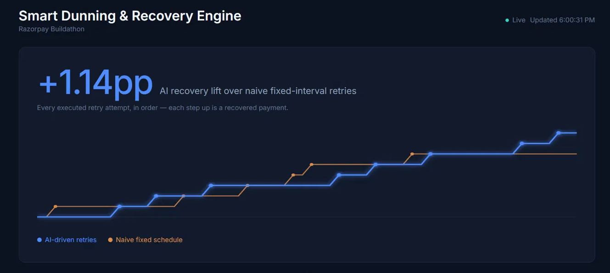

# Smart Dunning & Recovery Engine

**Built for the Razorpay Buildathon.**

🔗 **Live:** [razorpay-dunning-engine.vercel.app](https://razorpay-dunning-engine.vercel.app) · Backend: deployed on Render
   

When a recurring payment fails, most systems retry it blindly on a fixed schedule — same 3 attempts, same intervals, regardless of *why* it failed. This engine classifies the failure reason with an LLM (Gemini) and drives retry timing, channel, and messaging around it — then proves the difference against a naive baseline, side by side, on the same live dataset.

## The core idea

Every simulated failed payment runs through **two parallel retry tracks** at once:

- **NAIVE** — a blind, fixed calendar: retry at 24h, then 96h, then 264h, always by email. This is what most systems actually do.
- **AI** — Gemini classifies the failure (insufficient funds vs. expired card vs. bank decline vs. gateway timeout), recommends a retry window, a channel, and whether to prompt for an alternate payment method. Retries run on exponential backoff + jitter around that window, with channel diversity instead of email-only.

Only the AI track is authoritative for a payment's real outcome (it's what would actually run in production) and only the AI track sends real email (via Resend). NAIVE runs as a genuine shadow simulation purely to produce the comparison numbers on the dashboard — the recovery-rate gap between the two tracks is the project's core proof point.

## Architecture

```
┌─────────────┐      ┌──────────────────┐      ┌─────────────────┐
│   React     │─────▶│   Spring Boot 4   │─────▶│    Supabase      │
│  Dashboard  │ REST │   (Java 25)       │ JDBC │   (PostgreSQL)    │
└─────────────┘      └──────────────────┘      └─────────────────┘
                              │
                 ┌────────────┼────────────┐
                 ▼                         ▼
          Gemini 3.6 Flash            Resend
       (classification +          (real email for
        message generation)        AI+EMAIL attempts)
```

- **Backend**: Spring Boot 4.1.1, Java 25, Spring Data JPA, PostgreSQL (Supabase)
- **AI**: Gemini 3.6 Flash via the Interactions API, with a rule-based fallback per failure code so a live demo survives an API outage
- **Email**: Resend, real delivery for AI-track EMAIL attempts
- **Frontend**: React + Vite + Tailwind v4 + Recharts
- **Deploy**: Backend on Render (Docker), frontend on Vercel

## Data model

`Customer` → `Payment` → `FailureEvent` (why it failed) → `RetryAttempt` × 6 per payment (3 NAIVE + 3 AI) → `RecoveryMessage` per executed attempt.

## Running it locally

See the build log in [`docs/build-log/`](./docs/build-log/) for the full day-by-day setup steps (Supabase, Gemini, Resend). Quick version:

**Backend:**
```powershell
$env:SPRING_DATASOURCE_URL = "..."
$env:SPRING_DATASOURCE_USERNAME = "..."
$env:SPRING_DATASOURCE_PASSWORD = "..."
$env:GEMINI_API_KEY = "..."
$env:RESEND_API_KEY = "..."
mvn spring-boot:run
```

**Frontend:**
```powershell
cd frontend
npm install
npm run dev
```

## API

| Endpoint | Purpose |
|---|---|
| `POST /api/failures` | Simulates a gateway failure webhook — ingests a failed payment, schedules both retry tracks |
| `GET /api/payments`, `GET /api/payments/{id}` | Inspect payments and their retry attempts |
| `GET /api/payments/{id}/messages` | Recovery messages generated/sent for a payment |
| `POST /api/admin/retries/force-run` | Demo helper — executes every pending attempt immediately, ignoring schedule |
| `GET /api/dashboard/funnel` | Payment outcome counts |
| `GET /api/dashboard/comparison` | AI vs. NAIVE recovery rate — the headline stat |
| `GET /api/dashboard/timeline` | Every executed attempt, for charting |

## Build log

- [`DAY1.md`](./docs/build-log/DAY1.md) — data model + seed data
- [`DAY2.md`](./docs/build-log/DAY2.md) — ingest endpoint + naive retry track
- [`DAY3.md`](./docs/build-log/DAY3.md) — Gemini classification + AI retry track
- [`DAY4.md`](./docs/build-log/DAY4.md) — message generation + Resend email
- [`DAY5.md`](./docs/build-log/DAY5.md) — dashboard APIs + frontend scaffold
- [`DAY6.md`](./docs/build-log/DAY6.md) — dashboard visual design
- [`DAY7.md`](./docs/build-log/DAY7.md) — deployment (Render + Vercel)
